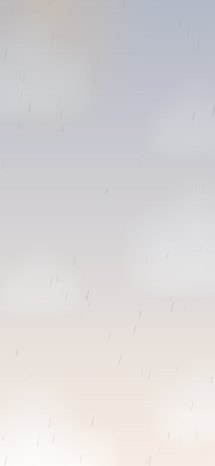
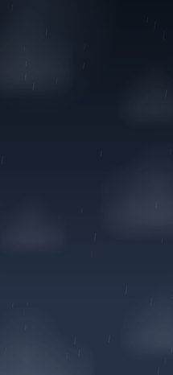
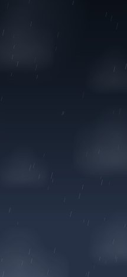

# Wallpapers

The sky from the [jere.ing](https://jere.ing) front door: four times of day, three kinds of weather. Clouds, colours, rain and lightning match the site.

- **Stills:** every sky, phone (1290 × 2796) and desktop (3840 × 2160). Tap a preview for the phone version.
- **Live (video):** rain and storm as 12-second loops that repeat without a seam (phone 1080 × 2340, desktop 1920 × 1080). Storms flash once per loop.
- **Live (web):** the real thing, running forever with drifting clouds, for Wallpaper Engine or Lively on Windows. Works for every sky, clear ones included.

## Stills

| | Clear | Rain | Storm |
|---|---|---|---|
| **Dawn** |  [phone](still/phone/dawn-clear.png) · [desktop](still/desktop/dawn-clear.png) |  [phone](still/phone/dawn-rain.png) · [desktop](still/desktop/dawn-rain.png) |  [phone](still/phone/dawn-storm.png) · [desktop](still/desktop/dawn-storm.png) |
| **Day** |  [phone](still/phone/day-clear.png) · [desktop](still/desktop/day-clear.png) |  [phone](still/phone/day-rain.png) · [desktop](still/desktop/day-rain.png) |  [phone](still/phone/day-storm.png) · [desktop](still/desktop/day-storm.png) |
| **Dusk** |  [phone](still/phone/dusk-clear.png) · [desktop](still/desktop/dusk-clear.png) |  [phone](still/phone/dusk-rain.png) · [desktop](still/desktop/dusk-rain.png) |  [phone](still/phone/dusk-storm.png) · [desktop](still/desktop/dusk-storm.png) |
| **Night** |  [phone](still/phone/night-clear.png) · [desktop](still/desktop/night-clear.png) |  [phone](still/phone/night-rain.png) · [desktop](still/desktop/night-rain.png) |  [phone](still/phone/night-storm.png) · [desktop](still/desktop/night-storm.png) |

## Live

| | Rain | Storm | Web (any weather) |
|---|---|---|---|
| **Dawn** | [phone](live/phone/dawn-rain.mp4) · [desktop](live/desktop/dawn-rain.mp4) | [phone](live/phone/dawn-storm.mp4) · [desktop](live/desktop/dawn-storm.mp4) | [clear](live/web/dawn-clear.html) · [rain](live/web/dawn-rain.html) · [storm](live/web/dawn-storm.html) |
| **Day** | [phone](live/phone/day-rain.mp4) · [desktop](live/desktop/day-rain.mp4) | [phone](live/phone/day-storm.mp4) · [desktop](live/desktop/day-storm.mp4) | [clear](live/web/day-clear.html) · [rain](live/web/day-rain.html) · [storm](live/web/day-storm.html) |
| **Dusk** | [phone](live/phone/dusk-rain.mp4) · [desktop](live/desktop/dusk-rain.mp4) | [phone](live/phone/dusk-storm.mp4) · [desktop](live/desktop/dusk-storm.mp4) | [clear](live/web/dusk-clear.html) · [rain](live/web/dusk-rain.html) · [storm](live/web/dusk-storm.html) |
| **Night** | [phone](live/phone/night-rain.mp4) · [desktop](live/desktop/night-rain.mp4) | [phone](live/phone/night-storm.mp4) · [desktop](live/desktop/night-storm.mp4) | [clear](live/web/night-clear.html) · [rain](live/web/night-rain.html) · [storm](live/web/night-storm.html) |

### Setting a live one

- **Android:** phones don't take a video as a wallpaper on their own. Use a video wallpaper app (for example *Video Live Wallpaper*) and pick the phone `.mp4`.
- **iPhone:** iOS has no looping video wallpapers. Use a still, or set a Live Photo made from the `.mp4` (it moves only when you press and hold).
- **Windows, Wallpaper Engine:** Create wallpaper → pick a file from `live/web/` (Web type). Or use a desktop `.mp4` as a Video wallpaper.
- **Windows, Lively Wallpaper (free):** + → choose a file from `live/web/`, or a desktop `.mp4`.
- **Mac:** Plash (free) shows a web page as the desktop: point it at a `live/web/` file.

`live/web/sky.html` takes any combination: `sky.html#dusk-storm`, or `sky.html?sky=dawn&weather=rain`. The web pages also shift a few pixels with the mouse, like the site.

## Remaking them

`python tools/wallpapers.py` (stills and videos; needs Playwright, Pillow, numpy and ffmpeg). The web pages: `python -c "import sys; sys.path.insert(0, 'tools'); import wallpapers; wallpapers.web()"`. Everything comes from `template.html` and the built `index.html`, so a change to the sky on the site carries over.

These live in the repo only; they aren't published on jere.ing. Same licence as the rest of the repo (see [LICENSE](../LICENSE)).
